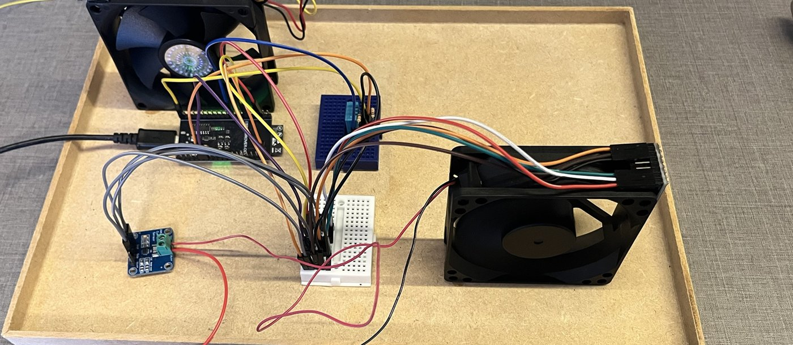
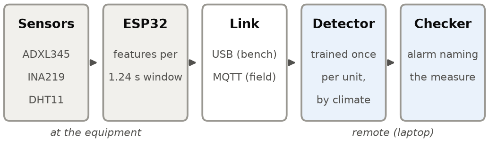

# Predictive maintenance for air-conditioning equipment

Embedded system that watches an air-conditioning unit in continuous operation
through its vibration and warns when it leaves the normal of that machine, in
that place and in that climate. It detects deviations and says which
measurement weighed most; it does not estimate the remaining useful life.

Course IBM3119, Embedded Systems Project (Ibmec, 2026). The full article, in
English, is in [`paper/predictive-maintenance.tex`](paper/predictive-maintenance.tex).

This project was developed in a repository shared with another project of the
course, and it was moved here with its commit history filtered. The commits
before the English translation have the files and comments in Portuguese. The
translation is in the commits that follow.

## What the article shows

A single model does not fit every unit: the same loose fan vibrated at 0.10 g
on one table and 0.18 g on another, more than an obstruction changes it. What
generalizes is the method: each unit learns its own normal where it is
installed, taking the room temperature and humidity into account, and the
detector, trained once, does not relearn, so that a slow fault does not become
the new normal.

With the fan fixed to a board, as a unit is installed, we made three real
faults on the bench: unbalance, a loose part and an obstruction. The detector
raised no false alarm on the healthy test stretches (night, hot afternoon and
another day) and caught all three: the unbalance through the vibration
strength, the loose part and the obstruction through the dominant frequency.
The fixed limit only saw the unbalance. The adaptive detector of the first
stage raised 5 to 8% of false alarms, saw the loose part late and never saw the
simulated slow fault.

## The bench

ESP32-WROVER-DEV, ADXL345 accelerometer, INA219 current sensor, DHT11 for the
room climate and a 12 V fan glued to a wooden board. The recordings are in
`data/`. The step-by-step assembly is in [`docs/assembly.md`](docs/assembly.md),
and each decision, with its reason, in
[`docs/design-decisions.md`](docs/design-decisions.md).



*The monitored fan is the one on the right, with the ADXL345 on its top edge.
The fan at the back is not used.*

## How to use

Inside this folder, once:

```
python3 -m venv .venv
.venv/bin/pip install -r analysis/requirements.txt
```

On Windows, double-clicking `install.bat` does the same.

Upload `firmware/esp32_acquisition` to the board (board "ESP32 Wrover Module",
libraries Adafruit INA219 and DHT sensor library), with `credentials.h` copied
from `credentials.h.example` and kept out of Git; the Wi-Fi only sets the clock
by NTP. Close the serial monitor and use the shortcuts (on the Mac, `./name`;
on Windows, `name.bat`):

| Shortcut | What it does |
|---|---|
| `record` | Records a session to `data/`, with the name you give, and shows the chart |
| `train` | Trains the model on the healthy recordings you choose and saves it to `model.pkl` |
| `check` | Runs a recording through the model: how much was out of the normal, by which measure, and a chart |
| `./plot` | Live chart only: vibration, current, speed and climate |
| `./present` | The adaptive detector panel of the first stage (`./present backup` plays a recorded session) |

To train on the board recordings, choose `board-bench-night`,
`board-bench-hot-afternoon` and `board-place6`. The tape recordings and
`board-front-obstructed` are faults: they are only for checking.

## Repository layout

The scripts live in `analysis/`. What runs the bench sits directly in it; the
rest sits in subfolders, and `paths.py` lets a script of any subfolder import
the others.

| Where | What it holds |
|---|---|
| `firmware/` | ESP32 acquisition sketch |
| `analysis/` | The system: `trained_baseline.py` (the detector of the article, trained once, with the room climate), `train.py` and `check.py`, `record.py` and `monitor.py` (recording and live chart) and `csv_format.py` (columns of the board CSV) |
| `analysis/evaluation/` | `compare_methods_real_faults.py` (Table I of the article: the three methods on the real faults and on the simulated slow fault) and `evaluate_real_faults.py` (the trained baseline on each board recording) |
| `analysis/figures/` | `architecture_figure.py` (Fig. 1b), `real_faults_figure.py` (Fig. 2) and `five_places_figure.py` (loose fan against the board in five places) |
| `analysis/ap1/` | The first-stage method: the adaptive detector (`adaptive.py`, used in the comparison of the article), the panel of `./present` and the two-baseline evaluation, with output in `results/ap1/` |
| `data/` | The recordings: `board-*` with the fan on its board, `loose-*` with the fan loose on a table, `rep1` to `rep3` from the first stage |
| `results/` | Evaluation reports and figures |
| `assets/` | Photo and architecture of the article |
| `paper/` | Article (`.tex`) and `refs.bib` |
| `docs/` | Bench assembly and design decisions |

## Architecture

The ESP32 computes the features of each ~1.24 s window (its own FFT included)
and sends one CSV line over USB. The detector runs on the computer, on the Mac
or on Windows.



*The sensors and the ESP32 stay at the unit; the detector and the checker, on the
computer.*

## What the detector learns and what is fixed

In training, it learns from each unit the normal of each measure (median and
spread) in each climate, the threshold of the Isolation Forest and the range of
the slow look. These values are fixed in `trained_baseline.py` and were tuned
on the bench fan, with no proof on other machines: the normal of each window
comes from the 600 training windows with the most similar climate (1 °C weighs
as much as 5 points of humidity); the ruler flags the vibration strength more
than 6 spreads above normal; the Isolation Forest only counts on two
consecutive windows with some deviation of 3 or more; the slow look uses the
3 min median, without the warm-up and without the base sway below 10 Hz; the
first 5 minutes of every recording are the motor warming up and neither enter
training nor raise alarms.

## Customizations

What the group built on top of the standard software (on the board, Arduino IDE
with the ESP32 core and the Adafruit INA219 and DHT sensor libraries; on the
computer, Python with numpy, pandas, scikit-learn, matplotlib and pyserial):

- ADXL345 read straight from its registers, with the FIFO in stream mode, with
  no library.
- Radix-2 FFT of our own on the board, with a Hann window and corrected gain,
  checked against known sines; real rate measured per window (414 Hz, not the
  nominal 400).
- Time by NTP, after the DS1302 measured time six times too fast.
- Sensor failure warnings (`# ALARM`) and an INA219 restart every 2 s.
- Current as the mean of the window, because the motor draws current in pulses,
  and the DHT11 read in the same line, for the room climate.
- Total measures, which do not change with the orientation of the sensor.
- Trained-baseline detector with the climate (`trained_baseline.py`): the
  scikit-learn Isolation Forest is only one of its three parts. Around it, the
  group built the normal chosen by climate neighbors, the robust rise-only
  ruler, the slow look against faults that grow slowly, the removal of the
  warm-up and of the base sway, and the message with the measure that weighed
  most.
- Adaptive detector of the first stage, kept for the comparison.
- Windows package: install, record, train and check with two clicks, with no
  internet after installation, so that whoever installs the unit can train its
  normal.
- Evaluation with real faults: each fault appended after a healthy stretch, as
  it appears in service, and compared with the adaptive detector and a fixed
  limit.

## What was left out, and why

- The tachometer: on the same motor it read from 0 to 4900 rpm, depending on how
  the wire sat. The speed comes from the dominant frequency of the vibration
  (46 Hz).
- The current in the alarm: it is still recorded, but raises no alarm. On the
  same board and with no fault, it went from 154 to 142 mA from one day to the
  next, from external factors such as the supply, and none of the three faults
  moved it.

## Limitations

- A single bench fan, which is not a compressor; fixed parameters tuned on it.
- Each fault was made only once; the climate ranged from 26 to 30 °C.
- Recordings of hours, not months.
- Without a count of FIFO overflows, the continuity of the 512 samples of each
  window is not proven yet.

## Documents

| File | Contents |
|---|---|
| `paper/predictive-maintenance.tex` | Article, in English, in the SBrT template |
| `paper/refs.bib` | References of the article and the repository entry |
| `docs/assembly.md` | Bench assembly and the recording routine |
| `docs/design-decisions.md` | Decisions taken, with the reason, and what was dropped |

The `.tex` uses the paths of the Overleaf project (`assets/` and `results/` in
the same folder as the file). To compile from the repository, copy those two
folders into `paper/` or adjust the paths.

## License

MIT, see [`LICENSE`](LICENSE).
